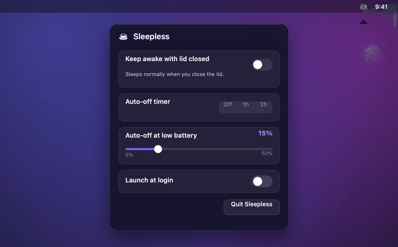

<!-- Language switcher. Keep this row identical across every README.<lang>.md. -->
<p align="center">
  <b>English</b> &nbsp;·&nbsp;
  <a href="README.zh-CN.md">简体中文</a> &nbsp;·&nbsp;
  <a href="README.es.md">Español</a> &nbsp;·&nbsp;
  <a href="README.ja.md">日本語</a> &nbsp;·&nbsp;
  <a href="README.fr.md">Français</a> &nbsp;·&nbsp;
  <a href="README.de.md">Deutsch</a>
</p>

<p align="center">
  <picture>
    <source media="(prefers-color-scheme: dark)" srcset="assets/hero-dark.gif">
    <source media="(prefers-color-scheme: light)" srcset="assets/hero-light.gif">
    
  </picture>
</p>

<p align="center">
  <b>Keep your MacBook awake with the lid closed, on battery, with no external display.</b><br>
  <sub>One menu-bar switch, with an auto-off timer and a battery-floor cutoff to help limit battery drain.</sub>
</p>

<p align="center">
  <a href="https://github.com/Aboudjem/Sleepless/actions/workflows/ci.yml"></a>
  <a href="https://github.com/Aboudjem/Sleepless/releases/latest"></a>
  <a href="https://github.com/Aboudjem/Sleepless/releases"></a>
  <a href="https://github.com/Aboudjem/Sleepless/stargazers"></a>
  <a href="LICENSE"></a>
  
</p>
<p align="center">
  
  
  
  <a href="https://github.com/Aboudjem/homebrew-tap"></a>
</p>

<p align="center">
  
</p>

> [!NOTE]
> A closed lid sleeps your Mac, and `caffeinate` apps (KeepingYouAwake and friends) can't change that, by design. Sleepless flips the one setting that can, `pmset disablesleep`, with battery, timer and watchdog recovery checks.

## Sleep recovery

Addresses [issue #8](https://github.com/Aboudjem/Sleepless/issues/8): quitting while ON must not leave sleep disabled after the in-app safety checks stop. Normal quit now restores Sleepless-owned state. An independent per-user watchdog recovers after a crash or force-quit using a 45-second lease, renewed every 10 seconds. Recovery normally takes about a minute; scheduling delays or revoked permissions can prevent timely recovery.

**Turn off when unplugged** is enabled by default and uses native power-source notifications. Disconnecting external power turns keep-awake OFF; reconnecting never turns it back ON. Disable this option deliberately if you need to keep working on battery.

Arming requires both exact sleep permissions and a healthy watchdog. Pre-existing unowned sleep prevention is left unchanged. macOS exposes a global Boolean without ownership identity, so concurrent changes by other tools cannot always be distinguished. See [recovery, deployment and test results](docs/WATCHDOG-SAFETY.md).

These changes are not in the existing public release or Homebrew cask until accepted and published. The watchdog design is adapted from [mmavko's fork](https://github.com/mmavko/Sleepless/tree/e06a994148d0f35b2096dc3893a9dd171a74dbc0); the original interface and app-bundle distribution remain.

## Install

```sh
brew install --cask aboudjem/tap/sleepless
/Applications/Sleepless.app/Contents/Resources/grant.sh   # one-time passwordless grant
```

| Other ways | |
|---|---|
| **Download** | Grab the [latest release](https://github.com/Aboudjem/Sleepless/releases/latest), unzip to `/Applications`, then approve it in **System Settings → Privacy & Security → Open Anyway** (it is ad-hoc signed). |
| **Build from source** | `git clone https://github.com/Aboudjem/Sleepless.git && cd Sleepless && ./install.sh` (no Gatekeeper prompt). |

For this branch, build from the checked-out source or use a build supplied by its contributor. Open the app and click the cup. The first ON requests native authorization for the two-command grant and installs the per-user watchdog; ON is blocked until it checks in. Keep its background item enabled. Before replacing an older copy, quit it normally and resolve any restoration error. Nothing automatically turns keep-awake ON after installation.

For complete removal, run the bundled `Contents/Resources/uninstall.sh` (or `./uninstall.sh` from source). It restores owned state before removing recovery and stops if restoration fails. Deleting the app alone leaves the watchdog and grant installed. The external Homebrew tap needs an uninstall-hook update before publishing this version; see the [deployment guide](docs/WATCHDOG-SAFETY.md#complete-removal).

## Features

| | | |
|---|---|---|
| ☕ | **One switch** | Click the menu-bar cup, flip the toggle. |
| ⏲️ | **Auto-off timer** | 1h or 2h with a live countdown, then off. |
| 🔋 | **Battery floor** | Auto-off at 5–50% on battery (default 15%). |
| 🪫 | **Low Power Mode** | Steps aside when LPM is on, on battery. |
| 🖥️ | **No dongle** | Lid closed, on battery. No monitor, no HDMI plug. |
| 🚀 | **Launch at login** | Optional, off by default, always starts idle. |
| 🔌 | **Power protection** | Default-on auto-off when external power is disconnected. |
| 🛟 | **Quit/crash recovery** | Owned-state cleanup and an independent per-user watchdog. |
| 🪶 | **Tiny + native** | AppKit, no Dock icon, root daemon or kext. |

**Menu-bar glyph:** empty cup = off · full cup = awake · full cup + dot = awake on battery (auto-off live).

## Sleepless vs the alternatives

| | **Sleepless** | Amphetamine | KeepingYouAwake | `caffeinate` |
|---|:---:|:---:|:---:|:---:|
| Awake, lid closed, no monitor | ✅ ¹ | ⚠️ ² | ❌ ³ | ❌ |
| On battery | ✅ | ✅ | ✅ lid open | ⚠️ ⁴ |
| Auto-off timer | ✅ | ✅ | ✅ | ❌ |
| Auto-off on low battery | ✅ | ✅ | ✅ | ❌ |
| Open source | ✅ MIT | ❌ App Store | ✅ MIT | Apple |
| Cost | Free | Free | Free | Free |

<sub>As of 2026-06. ¹ Uses `pmset disablesleep` and reads the flag back; behavior is hardware/macOS-version dependent. ² Documents closed-display mode but is widely reported to fail on Apple Silicon on power-source changes ([AE #28](https://github.com/x74353/Amphetamine-Enhancer/issues/28)); the app is closed source. ³ Can't do lid-closed by design, it wraps `caffeinate` ([#66](https://github.com/newmarcel/KeepingYouAwake/issues/66)). ⁴ `caffeinate -i` runs on battery; `-s` is AC-only.</sub>

## Use it to

- 🤖 Finish overnight jobs lid-closed: agent runs, builds, renders, ML training.
- 📡 Share a hotspot from your bag.
- ⬇️ Leave big downloads, uploads, or backups running.
- 🖥️ Keep a local server or SSH session reachable.

> [!TIP]
> Set a battery floor you trust (say 20%) plus a timer, and you can walk away without babysitting the battery.

## How it works

Sleepless toggles `pmset disablesleep` (the kernel's `SleepDisabled` flag), reads it back so the menu bar never lies, and reverts it at your battery floor, in Low Power Mode, when the timer ends, or on reboot. A GUI app can't type a password, so the installer adds a scoped sudoers rule for **exactly two commands**:

```
<you> ALL=(root) NOPASSWD: /usr/bin/pmset -a disablesleep 0, /usr/bin/pmset -a disablesleep 1
```

- **Can't be widened.** sudoers matches arguments literally, no wildcards.
- **Narrow privilege:** the unprivileged safety helper passes an argument array directly to `sudo`; the grant authorizes Apple’s `/usr/bin/pmset`, never a user-writable script.
- **Recovery:** clean quit, power removal (default), the floor, timer and independent watchdog restore owned state when permissions allow. Uninstallation verifies normal sleep before removing recovery.

Verify a download, no Apple account needed:

```sh
shasum -a 256 -c SHA256SUMS
gh attestation verify Sleepless-*.zip -R Aboudjem/Sleepless
```

Full threat model, the App Store verdict, and the audit guide: [SECURITY.md](SECURITY.md) · [docs/AUDIT.md](docs/AUDIT.md).

## FAQ

<details>
<summary><b>Does <code>pmset disablesleep</code> still work on Apple Silicon (M1/M2/M3)?</b></summary>

Yes. `pmset -a disablesleep 1` sets the kernel's `SleepDisabled` flag on Apple Silicon, confirmed firsthand on macOS 26.3, which keeps the Mac awake with the lid closed on battery. Verify with `pmset -g | grep SleepDisabled` (it should read `1`). Claims that it "stopped working" usually describe `caffeinate` or caffeinate-based apps, a different mechanism.
</details>

<details>
<summary><b>Why does my Mac sleep on lid close even with Amphetamine or KeepingYouAwake?</b></summary>

Those use macOS power assertions, which stop the idle timer but can't override the hardware lid-close trigger. KeepingYouAwake wraps `caffeinate`, which can't do lid-closed ([#66](https://github.com/newmarcel/KeepingYouAwake/issues/66)). `pmset disablesleep`, which Sleepless uses, can.
</details>

<details>
<summary><b>Is it safe? Will it overheat or drain the battery?</b></summary>

Live flag recovery passed on macOS 26.5.2; unplug and force-quit recovery were also confirmed by a user on macOS 26.6.2. Actual sleep still requires separate checks. Heavy sustained load with the lid fully shut reduces airflow, so use judgement. Battery, timer and watchdog checks reduce risk, but failed permissions can prevent restoration. Supervised hardware testing is required before everyday use.
</details>

<details>
<summary><b>Does it need sudo, a kernel extension, or a daemon?</b></summary>

One tightly scoped `sudo` grant (two exact `pmset` commands) so a GUI app can flip the setting without a prompt. No kernel extension or root daemon. The native AppKit interface uses a small independent safety helper and per-user watchdog.
</details>

<details>
<summary><b>How do I stop it or remove it?</b></summary>

Flip the switch off, or let the timer or battery floor do it, and normal sleep returns. A reboot also resets it. `./uninstall.sh` restores owned state and verifies normal sleep before removing the watchdog, app, login item and scoped grant. It stops on failed restoration. See the [deployment guide](docs/WATCHDOG-SAFETY.md) for complete removal and Homebrew integration.
</details>

<details>
<summary><b>Why isn't it notarized?</b></summary>

It is a personal open-source tool with no paid Apple Developer ID, so it is ad-hoc signed. Build from source to skip Gatekeeper, or use **Open Anyway** for the prebuilt app. The notarization steps are documented in [docs/AUDIT.md](docs/AUDIT.md).
</details>

## Contributing

Issues and PRs welcome, especially translations and reports from other hardware. See [CONTRIBUTING.md](CONTRIBUTING.md) and the [Code of Conduct](CODE_OF_CONDUCT.md). Sleepless stays deliberately small.

## License

[MIT](LICENSE) © 2026 Adam Boudjemaa.

<p align="center">
  <sub>If Sleepless saved you a trip to Terminal, a ⭐ helps other people find it.</sub>
</p>
