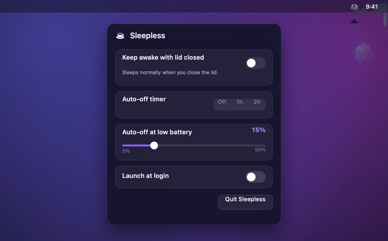

<!-- Language switcher. Keep this row identical across every README.<lang>.md. -->
<p align="center">
  <b>English</b> &nbsp;·&nbsp;
  <a href="README.zh-CN.md">简体中文</a> &nbsp;·&nbsp;
  <a href="README.es.md">Español</a> &nbsp;·&nbsp;
  <a href="README.ja.md">日本語</a> &nbsp;·&nbsp;
  <a href="README.fr.md">Français</a> &nbsp;·&nbsp;
  <a href="README.de.md">Deutsch</a>
</p>

> 本翻译由社区或机器生成，可能落后于英文版 README。请以英文版本为准。请参阅 [English README](README.md)。

<p align="center">
  <picture>
    <source media="(prefers-color-scheme: dark)" srcset="assets/hero-dark.gif">
    <source media="(prefers-color-scheme: light)" srcset="assets/hero-light.gif">
    
  </picture>
</p>

<p align="center">
  <b>合盖、使用电池、没有外接显示器，照样让 MacBook 保持唤醒。</b><br>
  <sub>一个菜单栏开关，配自动关闭定时器和电量下限截止，让你永远不会把电耗光。</sub>
</p>

<p align="center">
  <a href="https://github.com/Aboudjem/Sleepless/actions/workflows/ci.yml"></a>
  <a href="https://github.com/Aboudjem/Sleepless/releases/latest"></a>
  <a href="https://github.com/Aboudjem/Sleepless/releases"></a>
  <a href="https://github.com/Aboudjem/Sleepless/stargazers"></a>
  <a href="LICENSE"></a>
  
</p>
<p align="center">
  
  
  
  <a href="https://github.com/Aboudjem/homebrew-tap"></a>
</p>

<p align="center">
  
</p>

> [!NOTE]
> Sleepless 将 `pmset disablesleep`、固定唤醒配置和 App 自有的 `caffeinate` 断言组合使用；开启前保存受影响的设置，关闭后恢复并验证。

## 安装

```sh
brew install --cask aboudjem/tap/sleepless
/Applications/Sleepless.app/Contents/Resources/grant.sh   # one-time passwordless grant
```

| 其他方式 | |
|---|---|
| **直接下载** | 获取[最新发布版本](https://github.com/Aboudjem/Sleepless/releases/latest)，解压到 `/Applications`，然后在 **系统设置 → 隐私与安全性 → 仍要打开** 里批准它（它是临时签名 ad-hoc）。 |
| **从源码构建** | `git clone https://github.com/Aboudjem/Sleepless.git && cd Sleepless && ./install.sh`（不会有 Gatekeeper 提示）。 |

然后点击菜单栏里的咖啡杯，拨动开关，合上盖子。

## 功能特性

| | | |
|---|---|---|
| ☕ | **一个开关** | 点击菜单栏里的咖啡杯，拨动开关。 |
| ↩️ | **精确恢复** | 开启前保存 Battery/AC 当前值，关闭后逐项恢复并验证。 |
| 🧰 | **完整唤醒配置** | 同时使用 `disablesleep`、系统/磁盘/网络设置和 `caffeinate -ims`。 |
| ⏲️ | **自动关闭定时器** | 1 小时或 2 小时，带实时倒计时，到点关闭。 |
| 🔋 | **电量下限** | 电池供电时在 5–50% 自动关闭（默认 15%）。 |
| 🪫 | **Low Power Mode** | 电池供电下若 LPM 开启，自动让位。 |
| 🖥️ | **无需转接** | 合盖、电池供电即可。不用显示器，不用 HDMI 插头。 |
| 🚀 | **登录时启动** | 可选，默认关闭，始终以关闭状态启动。 |
| 🪶 | **小巧且原生** | AppKit 菜单栏应用。无 Dock 图标、守护进程或 kext。 |

**菜单栏图标：** 空杯 = 关闭 · 满杯 = 唤醒 · 满杯加一个点 = 电池供电下唤醒（自动关闭生效中）。

## Sleepless 与其他方案对比

| | **Sleepless** | Amphetamine | KeepingYouAwake | `caffeinate` |
|---|:---:|:---:|:---:|:---:|
| 合盖、无显示器时保持唤醒 | ✅ ¹ | ⚠️ ² | ❌ ³ | ❌ |
| 电池供电 | ✅ | ✅ | ✅ 开盖 | ⚠️ ⁴ |
| 自动关闭定时器 | ✅ | ✅ | ✅ | ❌ |
| 低电量时自动关闭 | ✅ | ✅ | ✅ | ❌ |
| 开源 | ✅ MIT | ❌ App Store | ✅ MIT | Apple |
| 价格 | 免费 | 免费 | 免费 | 免费 |

<sub>数据截至 2026-07。¹ 组合使用 `pmset disablesleep`、完整唤醒配置与应用自己持有的 `caffeinate -ims`；具体表现仍取决于硬件和 macOS 版本。² 有记载支持合盖显示模式，但被普遍反映会在电源切换时于 Apple Silicon 上失效（[AE #28](https://github.com/x74353/Amphetamine-Enhancer/issues/28)）；应用本身闭源。³ 从设计上就做不到合盖唤醒，因为它封装的是 `caffeinate`（[#66](https://github.com/newmarcel/KeepingYouAwake/issues/66)）。⁴ `caffeinate -i` 可在电池供电下运行；`-s` 仅在接通电源时有效。</sub>

## 用它来……

- 🤖 合盖跑完通宵任务：智能体运行、构建、渲染、ML 训练。
- 📡 从包里共享一个热点。
- ⬇️ 让大文件下载、上传或备份继续运行。
- 🖥️ 让本地服务器或 SSH 会话保持可达。

> [!TIP]
> 设一个你信得过的电量下限（比如 20%）再加一个定时器，你就能放心走开，不用一直盯着电量。

## 工作原理

开启时，Sleepless 先保存会被修改的 Battery、AC 和可选 UPS 参数，然后执行：

```sh
pmset -a disablesleep 1 sleep 0 disksleep 0 displaysleep 10 \
  powernap 0 tcpkeepalive 1 womp 1
caffeinate -ims
```

该配置刻意没有使用 `caffeinate -d`，因此显示器仍可正常息屏。关闭时，按 Battery/AC 分别恢复每个旧值；只有验证全部成功后才删除快照。

安装程序会把固定 helper 以 `root:wheel` 安装到 `/Library/PrivilegedHelperTools`，sudoers 只允许：

```text
<you> ALL=(root) NOPASSWD: /Library/PrivilegedHelperTools/com.aboudjem.Sleepless.powerctl on, /Library/PrivilegedHelperTools/com.aboudjem.Sleepless.powerctl off
```

- **输入固定。** helper 不接受调用者传入任何设置名或设置值。
- **恢复可重试。** 恢复失败会保留快照，不会假装成功。
- **不误杀进程。** 只停止 Sleepless 自己启动的 `caffeinate`。

完整威胁模型见 [SECURITY.md](SECURITY.md)。

## 常见问题

<details>
<summary><b>为什么不只使用 <code>pmset disablesleep 1</code>？</b></summary>

`disablesleep` 会设置合盖路径所需的未公开内核标志，但一个标志并不是所有长任务端到端连续的保证。Sleepless 还会关闭受影响的空闲计时器、保留网络相关设置，并持有自己的 `caffeinate -ims` 断言；应用后会验证完整配置。
</details>

<details>
<summary><b>为什么装了 Amphetamine 或 KeepingYouAwake，合盖时 Mac 还是会睡眠？</b></summary>

那些工具使用 macOS 电源断言，可以阻止空闲睡眠，却不能单独覆盖合盖触发路径。KeepingYouAwake 封装的是 `caffeinate`，本身不支持合盖运行（[#66](https://github.com/newmarcel/KeepingYouAwake/issues/66)）。Sleepless 将用于合盖路径的 `disablesleep`、自身断言和固定配置组合起来。
</details>

<details>
<summary><b>合盖运行安全吗？会过热或耗光电池吗？</b></summary>

下载、同步和 agent 任务等轻量无人值守工作是主要使用场景。完全合盖下持续高负载可能减少散热余量，请关注温度并自行判断。电量下限、Low Power Mode 自动关闭和定时器只能降低电池风险，不是温控保证。
</details>

<details>
<summary><b>它需要 sudo、内核扩展或后台守护进程吗？</b></summary>

它需要一条范围严格限定的 `sudo` 授权，只允许 root-owned helper 的精确 `on` 和 `off` 命令。没有内核扩展或守护进程。
</details>

<details>
<summary><b>怎样停止它或移除它？</b></summary>

把开关关掉，或者让定时器或电量下限替你关掉它；Sleepless 会恢复并验证保存的配置。`./uninstall.sh` 会先恢复，再移除应用、helper、登录项和 sudoers 授权。
</details>

<details>
<summary><b>为什么它没有公证？</b></summary>

它是一个个人的开源工具，没有付费的 Apple Developer ID，所以采用临时签名（ad-hoc）。从源码构建可以跳过 Gatekeeper，或者对预构建的应用使用 **仍要打开**。公证步骤记录在 [docs/AUDIT.md](docs/AUDIT.md) 中。
</details>

## 参与贡献

欢迎提交 Issue 和 PR，尤其欢迎翻译以及来自其他硬件的测试报告。请参阅 [CONTRIBUTING.md](CONTRIBUTING.md) 和[行为准则](CODE_OF_CONDUCT.md)。Sleepless 会刻意保持小巧。

## 许可证

[MIT](LICENSE) © 2026 Adam Boudjemaa。

<p align="center">
  <sub>如果 Sleepless 帮你省去了一趟终端，点个 ⭐ 能帮助更多人发现它。</sub>
</p>
